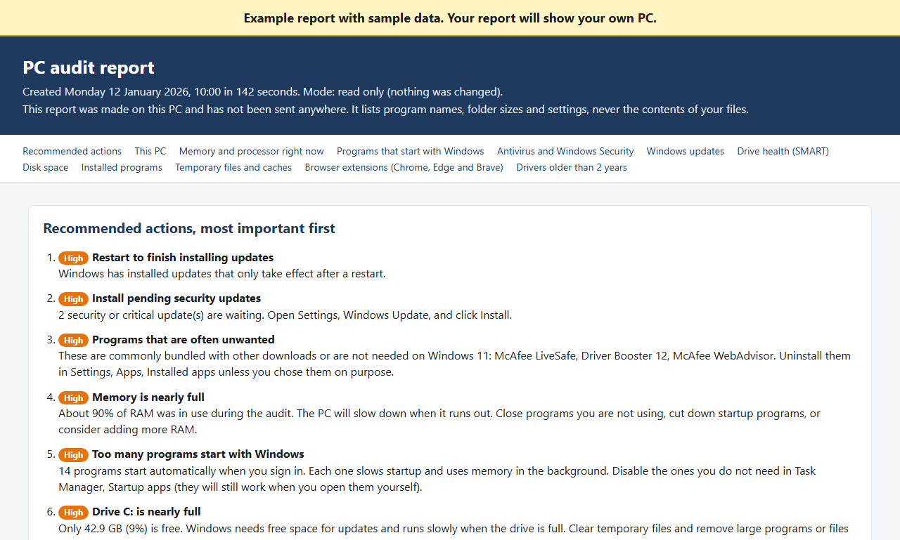

# PC Security Audit

Checks a Windows 10 or 11 PC for common health and security problems and writes a plain English report called `report.html`.

It is one PowerShell script (`audit.ps1`). It is read only by default, needs no administrator rights, installs nothing and has no code that connects to the internet.



See a full example report with sample data: [example_report.html](example_report.html).

## What it checks

* Programs that start with Windows, and roughly how heavy each one is
* Disk space, and which folders use the most room
* Installed programs, with size and install date
* Windows updates waiting to be installed, and whether a restart is needed
* Temporary files, caches and the recycle bin
* Browser extensions in Chrome, Edge and Brave, flagging any that can read every website you visit
* Drivers from hardware makers that are more than 2 years old
* Drive health (SMART)
* Memory and processor use, and which programs use the most
* Whether Windows Defender or another antivirus is on and up to date
* A list of recommended actions, most important first

## How to run it

1. Download `audit.ps1`.
2. Right click it and choose **Run with PowerShell** (on Windows 11: **Show more options** first).
3. If asked about an Execution Policy Change, type `Y`. It applies to that one window only.
4. Wait 1 to 5 minutes. The report opens in your browser.

Or from a terminal in the same folder:

```
powershell -ExecutionPolicy Bypass -File .\audit.ps1
```

## Is it safe?

Read it first: it is a single plain text file. Everything it does is written to `audit.log` next to the script.

* It does not open, read, move or delete personal files. For your own folders it only adds up sizes.
* It changes nothing unless you type `FIX` at the end, and then it asks before every change.
* The report contains program names, folder names and sizes, hardware details and your Windows user name inside folder paths. It does not contain passwords or browsing history. Check it before sharing it.

## Requirements

Windows 10 or 11. Works on Windows PowerShell 5.1 (built in) and PowerShell 7.

## Licence

MIT. See the [LICENSE](LICENSE) file.
